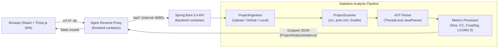

# ArchEv — Architecture Evaluator for Spring Boot Applications

**ArchEv** is a full-stack static analysis web application that evaluates the architectural quality and maintainability of monolithic **Java / Spring Boot** projects and visualizes the results in an interactive **3D WebGL dashboard**.

It parses Java source code into Abstract Syntax Trees (ASTs), classifies classes into Spring Boot architectural layers, computes established object-oriented software metrics (size, complexity, coupling, instability, and cohesion), and renders each class as an interactive 3D building block so developers can spot architectural smells without manually crunching metric tables.

---

## Table of Contents

- [Features](#features)
- [Architecture](#architecture)
- [Tech Stack](#tech-stack)
- [Prerequisites](#prerequisites)
- [Getting Started](#getting-started)
- [API Reference](#api-reference)
- [Configuration](#configuration)
- [Testing & Quality](#testing--quality)
- [Scope & Limitations](#scope--limitations)
- [License](#license)

---

## Features

### Multi-Source Project Ingestion
- **Archive Upload:** Upload `.zip` or `.tar` project archives up to **150 MB** directly from the browser.
- **GitHub Repository Analysis:** Analyze public GitHub repositories via HTTPS URL (automatically tries the `main` branch and falls back to `master` on HTTP `404`).
- **Local Filesystem Analysis (Dev Only):** Analyze a local directory path when explicitly enabled via the `dev` profile (`archev.local-analysis.enabled=true`).

### Static Analysis & Software Metrics
- **Java 21 AST Parsing:** Powered by JavaParser with support for modern Java constructs (`class`, `abstract class`, `interface`, `record`, `enum`, and `@interface`).
- **Automatic Layer Classification:** Groups classes into Spring Boot layers (`Entity`, `Document`, `Repository`, `Service`, `Controller`, `Test`, and `Other`) and extracts project metadata from Maven (`pom.xml`) and Gradle (`build.gradle` / `build.gradle.kts`) descriptors.
- **Per-Class Metrics:**
  - **Size & Structure:** Lines of Code (LOC), method count, attribute count, and statement count.
  - **Complexity:** Approximate McCabe Cyclomatic Complexity (CC).
  - **Coupling & Instability:** Afferent coupling ($C_a$), Efferent coupling ($C_e$), and Instability ($I = \frac{C_e}{C_a + C_e}$) resolved using fully qualified names (FQNs).
  - **Cohesion:** Lack of Cohesion of Methods (**LCOM1–LCOM5**), including connected-components LCOM4 and Henderson-Sellers LCOM5.

### Interactive 3D Visualization
- **3D Architectural Map:** Built with Three.js and React Three Fiber; classes are arranged by architectural layer with visual encodings for size, complexity, cohesion, and instability.
- **Dependency Inspection:** Selecting a class highlights its incoming, outgoing, and bidirectional dependencies in 3D space and opens a detailed metrics panel.
- **Performance & Resilience:** Shared unit geometry, automatic rendering pause (`frameloop="demand"`) when the browser tab is hidden or vibration is toggled off, WebGL context-loss handling, and a React `ErrorBoundary` around the dashboard.

### Hardened Ingestion & Error Handling
- **Archive Safety:** Protects against Zip Slip (path traversal), Zip Bombs (300 MB total extracted cap, 20 MB per entry, 10,000 entry limit), and `.tar` symlinks/hardlinks.
- **Standardized API Errors:** Returns RFC 7807 `ProblemDetail` payloads with structured status codes and human-readable diagnostics without leaking internal server paths.

---

## Architecture

### System Overview



The backend is **completely stateless**—there is no database at runtime. Uploaded archives and downloaded repositories are extracted into isolated temporary directories and cleaned up automatically after analysis completes (or fails).

### Repository Structure

```text
architecture-evaluator/
├── backend/                     # Java 21 / Spring Boot 3.4 REST API & static analyzer
│   ├── src/main/java/io/github/opsord/architecture_evaluator_backend/
│   │   └── modules/
│   │       ├── api/
│   │       │   ├── orchestrator/     # REST controller, ingestion, archive security, RFC 7807 handler
│   │       │   ├── project_scanner/  # Source discovery, Maven (pom.xml) & Gradle parsers
│   │       │   ├── parser/           # JavaParser AST visitors & class/method/statement models
│   │       │   └── processor/        # Program, Complexity (CC), Coupling & Cohesion (LCOM1-5) metrics
│   │       └── config/               # Externalized CORS configuration
│   ├── src/test/java/                # JUnit 5 & Mockito unit and integration tests
│   ├── Dockerfile                    # Multi-stage Eclipse Temurin 21 Alpine image (non-root)
│   └── pom.xml
├── frontend/                    # React 19 + TypeScript + Tailwind CSS v4 + Three.js SPA
│   ├── src/
│   │   ├── components/               # Layout, ProjectLoad forms, 3D Dashboard & ErrorBoundary
│   │   ├── context/                  # In-memory NavigationContext & ProjectContext
│   │   ├── hooks/                    # Shared analysis hook (AbortController & error state)
│   │   ├── services/                 # Axios API client (180s timeout, ProblemDetail parsing)
│   │   └── types/                    # TypeScript DTOs aligned with backend models
│   ├── Dockerfile                    # Multi-stage Node 20 build -> Nginx Alpine runtime
│   └── package.json
├── .github/workflows/           # CI pipelines: Backend, Frontend, SonarCloud & Docker smoke test
└── docker-compose.yml           # Full-stack local deployment (Nginx :80 -> Backend :8080)
```

---

## Tech Stack

| Layer | Technologies |
|-------|-------------|
| **Backend** | Java 21 LTS, Spring Boot 3.4.5, Spring Web, Spring Actuator, JavaParser 3.26.3, Apache Commons Compress 1.27.1, Lombok, JUnit 5, Mockito, JaCoCo |
| **Frontend** | React 19, TypeScript 5.8, Vite 6, Tailwind CSS v4, Three.js 0.177, `@react-three/fiber`, `@react-three/drei`, Axios, pnpm 10 |
| **Infrastructure** | Docker (multi-stage builds, non-root backend user, container `HEALTHCHECK`), Docker Compose, Nginx |
| **CI / Quality** | GitHub Actions (`backend.yml`, `frontend.yml`, `docker.yml`), SonarCloud, ESLint 9 |

---

## Prerequisites

Choose one of the following setups:

- **Docker setup (Recommended):**
  - **Docker** and **Docker Compose** (v2+)
- **Local development setup:**
  - **Java 21 LTS** (JDK 21, e.g., Eclipse Temurin)
  - **Node.js 20+** (Node 18+ supported)
  - **pnpm 10+** (enable via `corepack enable`)

---

## Getting Started

### Option 1: Run with Docker Compose (Recommended)

From the repository root:

```bash
docker compose up --build
```

Once both containers pass their health checks, open **[http://localhost](http://localhost)** in your browser.

- **Frontend (Nginx):** Exposed on host port `80`. Serves the production SPA and reverse-proxies `/api/` to `backend:8080` with a `150m` body limit and `180s` proxy timeouts.
- **Backend (Spring Boot):** Runs internally on port `8080` inside the Docker bridge network (not published to the host). Health is monitored via `GET /actuator/health`.

To stop the stack:

```bash
docker compose down
```

### Option 2: Run Locally for Development

Run the backend and frontend in separate terminals from their respective subdirectories (do not run Maven or pnpm from the repository root).

#### 1. Start the Backend

```bash
cd backend
./mvnw spring-boot:run -Dspring-boot.run.profiles=dev
```

On Windows PowerShell / CMD:

```powershell
cd backend
.\mvnw.cmd spring-boot:run "-Dspring-boot.run.profiles=dev"
```

The API will listen on `http://localhost:8080`. Enabling the `dev` profile also unlocks the local filesystem analysis endpoint (`POST /api/orchestrator/analyze`).

#### 2. Start the Frontend

```bash
cd frontend
corepack enable
pnpm install
pnpm dev
```

Open **[http://localhost:5173](http://localhost:5173)** in your browser. Vite automatically proxies `/api/orchestrator` requests to `http://localhost:8080`.

> **Tip:** In development mode (`pnpm dev`), `ProjectContext` can load a bundled mock dataset (`src/services/MockData/response-zip.json`) so you can explore the 3D dashboard without running an analysis first. This mock JSON is excluded from production builds.

---

## API Reference

All analysis endpoints are served under `/api/orchestrator` and return a gzipped JSON `ProjectAnalysisInstance` payload (null fields omitted).

| Method | Endpoint | Parameters | Description |
|--------|----------|------------|-------------|
| `POST` | `/api/orchestrator/analyze-upload` | `multipart/form-data` field `project` | Analyzes an uploaded `.zip` or `.tar` archive (max **150 MB**). |
| `POST` | `/api/orchestrator/analyze-github` | Query `repoUrl` | Downloads and analyzes a public GitHub repository HTTPS URL (`main` → `master` fallback). |
| `POST` | `/api/orchestrator/analyze` | Query `projectPath` | Analyzes a local directory on the server. **Disabled by default (`403 Forbidden`)**; enabled only when `archev.local-analysis.enabled=true` (e.g., `dev` profile). |
| `GET` | `/actuator/health` | — | Spring Boot Actuator health check used by Docker. |

### Error Responses (RFC 7807)

Errors return `application/problem+json` (`ProblemDetail`) with appropriate HTTP status codes:

- `400 Bad Request` — Invalid input, missing parameters, or unsupported archive type.
- `403 Forbidden` — Local filesystem analysis endpoint is disabled.
- `404 Not Found` — Target project path or GitHub repository/branch not found.
- `413 Payload Too Large` — Upload or archive exceeds size/entry safety limits.
- `422 Unprocessable Entity` — Archive extraction failed (e.g., corrupted archive or path traversal attempt).
- `502 Bad Gateway` — Upstream GitHub download failure or timeout.

---

## Configuration

Backend behavior can be customized via `backend/src/main/resources/application.properties` or environment variables:

| Property | Default | Description |
|----------|---------|-------------|
| `server.port` (`SERVER_PORT`) | `8080` | HTTP port for the Spring Boot server. |
| `archev.local-analysis.enabled` | `false` (`true` in `dev`) | Enables or disables `POST /api/orchestrator/analyze`. |
| `archev.cors.allowed-origins` | `http://localhost:3000`, `http://127.0.0.1:3000`, `http://localhost:5173`, `http://localhost`, `http://localhost:80` | Comma-separated list of allowed CORS origins. |
| `spring.servlet.multipart.max-file-size` | `150MB` | Maximum single uploaded archive size. |
| `spring.servlet.multipart.max-request-size` | `150MB` | Maximum multipart request size. |

---

## Testing & Quality

### Backend Tests & Coverage

Run from `backend/`:

```bash
# Run unit and integration tests
./mvnw test

# Run full verification with JaCoCo coverage report
./mvnw -B verify -Pcoverage
```

### Frontend Linting & Production Build

Run from `frontend/`:

```bash
# Lint TypeScript and React code
pnpm lint

# Type-check and build production bundle
pnpm build
```

### Continuous Integration

GitHub Actions automatically validates every push and pull request to `main`:
- **Backend CI & SonarCloud** (`.github/workflows/backend.yml`): Runs Maven verify with JaCoCo coverage on JDK 21 and uploads analysis to SonarCloud.
- **Frontend CI & SonarCloud** (`.github/workflows/frontend.yml`): Runs `pnpm lint`, `pnpm build`, and SonarCloud analysis.
- **Docker Build & Smoke Test** (`.github/workflows/docker.yml`): Builds both images with Docker Compose, waits for healthy containers, and runs an end-to-end upload smoke test through Nginx.

---

## Scope & Limitations

- **Target Scope:** Static structural analysis of monolithic **Java / Spring Boot** applications (Maven and Gradle projects).
- **Limitations:**
  - Does not support non-Java languages or non-Spring architectural patterns.
  - Designed for monolithic architectures; does not aggregate cross-service calls across microservices or serverless functions.
  - Static analysis only—does not perform runtime profiling, dynamic analysis, or load testing.
  - Analysis results are stored in browser memory for the current session and are not persisted across page refreshes.

---

## License

This project is licensed under the **MIT License**. See [LICENSE](./LICENSE) for details.
